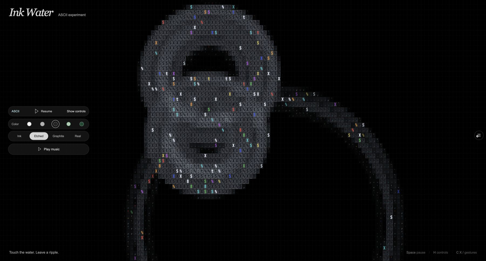

# ASCII water experiment

Branch: `experiment/ascii-water`, based on `3e2dfef99ee5b825584faf7e913bab73776547d8`.

The existing water simulation, pointer input, fixed timestep, independent rain
field, absorbing boundaries, normals and caustic generation are unchanged.
`AsciiWaterPresentation` adds a final fullscreen GPU pass that reads the displayed
heightfield and original scene. It never writes to any simulation target and does
not consume the physical `Math.random` stream, so seeded rain retains its original
sequence. Three.js creates resource UUIDs using randomness; ASCII construction
isolates those allocations in a separate synchronous seeded stream and restores
the original generator before returning.

The visual reference is [ASCII Sharks](https://github.com/stackedlol/ascii-sharks)
by stackedlol, inspected at `c521e24`. This experiment independently implements
the same tall character-cell proportions, black grid, cool gray blocks, sparse
edge marks, `:;t%SX8#@` density ramp, cyan wake dots and occasional colored glints.
It does not include the shark/boid simulation or copy its renderer source.

ASCII is on by default. Press **A** or the **ASCII** button to compare with the
original drawing without resetting the water. `?ascii=0` starts with the original
view. The controls also provide character size and a colored-glints switch.
Click, drag, rain, Space, H and the C/X/slash gestures keep their existing behavior.

[Open the experimental preview](https://puddle-water-study-git-experiment-97cd67-lekandigitals-projects.vercel.app).



The water settings remain owned by `WaterControls`; ASCII controls belong to the
presentation and cannot modify speed, impulses or the rain clock.

## Verification

The existing regression suite, TypeScript check and static production build pass.
The browser comparison checks all four channels of both ping-pong buffers in both
the touch and independent rain solvers against the unchanged base. It also checks
that disabling ASCII restores the exact original canvas pixels, presentation
controls leave the GPU fields untouched, pause holds both solvers, and native
mobile taps and portrait/landscape resizing work.

Run the GPU comparison with a local Chromium executable and a dependency-installed
checkout of the base commit:

```sh
CHROME_PATH=/path/to/chromium INK_WATER_SOURCE=../ink-water-base \
  node scripts/verify-ascii-browser.mjs
```
